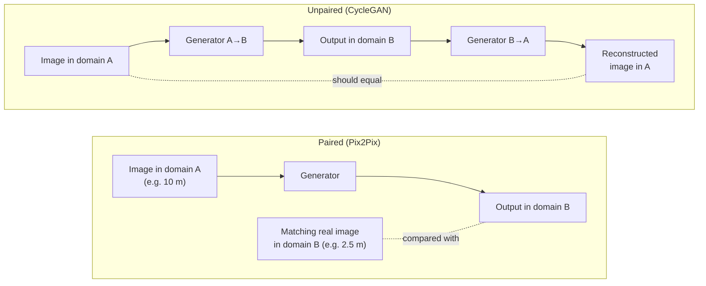

---
site:
  outline_maxdepth: 2
---

# Translation concepts

<!-- markdownlint-disable MD033-->
<div class="page-subtitle">
Domains, paired data, and the difference between generated and observed
</div>
<!-- markdownlint-enable MD033 -->

---

The previous page scoped what this lesson covers. This page builds the conceptual vocabulary, domains, paired versus unpaired training, training objectives, and generated-versus-observed output, that the rest of the lesson relies on, even though only {term}`super-resolution <Super-Resolution>` gets a full workflow.

---

## 1. Motivation

The single most important idea in this entire lesson is introduced here: a translated image is a plausible reconstruction, not a direct observation. Understanding why that is true, structurally, from how these models are trained, is what will let you use super-resolved imagery responsibly on the later pages, rather than as a rule you simply have to take on faith.

---

## 2. Core idea

{term}`Image translation <Image Translation>` learns a mapping from an input image in one domain to an output image in a different domain. A "domain" here just means a particular kind of image: 10-meter Sentinel-2 imagery is one domain, 2.5-meter imagery is another; {term}`synthetic aperture radar (SAR) <Synthetic Aperture Radar>` imagery is one domain, optical imagery is another. Crucially, the mapping preserves spatial structure: a building in the input stays in the same location in the output, even though its appearance changes.

What the model produces between those fixed locations depends on two things: **what data it was trained on**, and **what it was rewarded for** during training.

---

## 3. Building the vocabulary

### A. Paired and unpaired translation

Early, influential translation frameworks like **Pix2Pix** learn from **paired** data: aligned examples of the same scene in both domains, for example a low-resolution image and its exact high-resolution counterpart. **CycleGAN** later extended the idea to **unpaired** settings, where aligned pairs are not available. It translates A → B and back B → A, and penalises the model if the round trip does not return the original image (the "cycle consistency" that gives it its name).



Which setting applies depends entirely on what training data exists for a given translation task; it is a property of the training setup, not something you choose independently at inference time. Super-resolution is usually trained with pairs: for the model used in this lesson, Sentinel-2 images paired with aerial images of the same places, page 8 returns to what that means.

### B. What the model is rewarded for

During training, a translation model is scored by a **{term}`loss function <Loss Function>`**, and the choice of loss shapes the output more than most people expect:

| Training objective | What it rewards | Typical output | Examples |
| --- | --- | --- | --- |
| **Pixel loss** (mean absolute or squared error against the true image) | Being close to the truth *on average* | Smooth, slightly blurry: when unsure, the model averages all plausible answers | {abbr}`SRCNN (Super-Resolution Convolutional Neural Network)`, {abbr}`EDSR (Enhanced Deep Super-Resolution network)` |
| **Adversarial loss** (a discriminator judges realism) | Looking like a real image | Sharp, realistic texture, including invented detail | Pix2Pix, CycleGAN, {abbr}`SRGAN (Super-Resolution Generative Adversarial Network)` |
| **Diffusion** (learn to remove noise step by step) | Producing a sample from the distribution of realistic images that match the input | Sharp detail, *different on every run* | {abbr}`SR3 (Super-Resolution via Repeated Refinement)`, {term}`LDSR-S2` (this lesson) |

Pix2Pix, CycleGAN and SRGAN are built on **{term}`generative adversarial networks (GANs) <Generative Adversarial Network>`**: a generator network produces candidate output images, and a discriminator network tries to tell generated images apart from real ones. Training pushes the generator to produce increasingly convincing output, since it improves specifically by fooling the discriminator, not by minimizing pixel-by-pixel error alone. The model you will use in this lesson takes the more recent diffusion approach, covered on page 4.

### C. Sharp or accurate: pick your balance

The table hides an uncomfortable fact, known as the **perception–distortion trade-off**: no model can be both *as accurate as possible on average* and *as realistic-looking as possible* at the same time. When the input does not determine the answer, a model that minimises average error must blur (the average of several plausible roofs is a smudge), and a model that produces crisp roofs must commit to one guess, which may be wrong. Blurry output is honest about its uncertainty; sharp output hides it.

### D. Generated, not observed

Because a generative translation model is trained to produce *convincing* output rather than to guarantee a physically correct one, its output is fundamentally a statistical prediction: a plausible image consistent with the input, given everything the model learned during training. This matters because the model has no way to verify its output against {term}`ground truth <Ground Truth>` at the moment it generates it; it produces its best guess, and that guess can be wrong, confidently and consistently wrong, in ways that are not obvious just by looking at the result.

```{admonition} Keep this distinction in view for the rest of the lesson
:class: important
Every later page in this lesson, including the workflow itself, builds on this one idea: translated output is generated, not measured. The uncertainty and limitations pages later in this lesson exist specifically because of this distinction, not as an afterthought.
```

---

## 4. Common pitfalls

- **Treating "paired" and "unpaired" as a choice you make.** It is determined by what training data was available when the model was built, not a setting you control when using a {term}`pre-trained model <Pre-Trained Model>`.
- **Assuming a convincing-looking output is a correct one.** GANs and {term}`diffusion models <Diffusion Model>` are specifically trained to produce realistic-looking results, which is a different goal from producing measurably accurate ones.
- **Reading blurriness as a flaw and sharpness as quality.** Blur can be the honest answer when the input is ambiguous; crisp detail can be a confident guess.
- **Forgetting that "generated, not observed" applies to every translation task, not just this lesson's super-resolution example.** The same caution applies to sensor translation, gap filling, and the other applications from the previous page.

---

## 5. Mini task

A classmate says, "the super-resolved image looks so sharp and realistic, it must be accurate." Using the concepts from this page, explain what is wrong with this reasoning in two or three sentences. Then: a second model produces a blurrier result of the same scene. Is it necessarily worse?

:::{dropdown} Sample solution
:class: note

Looking realistic and being accurate are not the same thing, precisely because these models are trained to produce plausible, convincing output rather than to guarantee correctness against ground truth. A model can generate a sharp, consistent, visually convincing detail, a road edge, a building corner, that simply does not correspond to anything actually on the ground, since it is filling in detail statistically rather than observing it directly.

The blurrier model is not necessarily worse. A model trained with a pixel loss averages the plausible answers where the input is ambiguous, which produces blur but also smaller average errors (the perception–distortion trade-off). Which one is "better" depends on the use: for visual interpretation the sharp one may help, for measurement the blurry one may mislead less.
:::

---

## 6. Key takeaways

- Image translation maps an input image from one domain to an output image in another, preserving spatial structure while changing a specific property.
- Paired training data (Pix2Pix) uses aligned examples in both domains; unpaired training (CycleGAN) uses cycle consistency instead of alignment.
- The training objective shapes the output: pixel losses give blurry averages, adversarial losses and diffusion give sharp but partly invented detail.
- No model can be maximally sharp and maximally accurate at once (the perception–distortion trade-off).
- Translated output is a generated, plausible reconstruction, not a direct observation; this distinction underlies the uncertainty and limitations pages later in this lesson.

### Further reading

- Isola et al. (2017), ["Image-to-Image Translation with Conditional Adversarial Networks"](https://arxiv.org/abs/1611.07004) — Pix2Pix, paired translation.
- Zhu et al. (2017), ["Unpaired Image-to-Image Translation using Cycle-Consistent Adversarial Networks"](https://arxiv.org/abs/1703.10593) — CycleGAN, unpaired translation.
- Ledig et al. (2017), ["Photo-Realistic Single Image Super-Resolution Using a Generative Adversarial Network"](https://arxiv.org/abs/1609.04802) — SRGAN, the first GAN for super-resolution.
- Blau and Michaeli (2018), ["The Perception-Distortion Tradeoff"](https://arxiv.org/abs/1711.06077) — why sharpness and accuracy cannot both be maximised.
