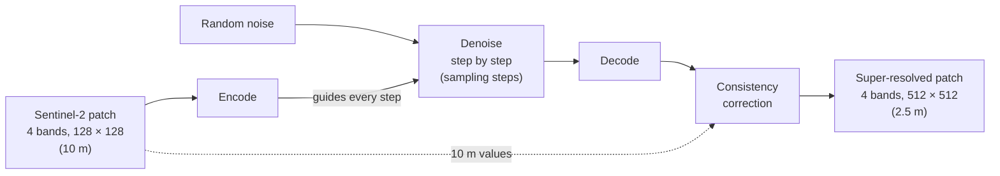

---
site:
  outline_maxdepth: 2
---

# Latent diffusion

<!-- markdownlint-disable MD033-->
<div class="page-subtitle">
A latent diffusion approach to super-resolution for Sentinel-2 imagery
</div>
<!-- markdownlint-enable MD033 -->

---

The previous page argued that super-resolution needs a genuinely generative approach, not simple upsampling. This page explains, at a student-facing level, how the specific model this lesson uses actually generates that detail, and how it keeps that detail consistent with what the sensor measured, before you run it yourself on the next page.

---

## 1. Motivation

`geoai`'s {term}`super-resolution <Super-Resolution>` function takes only a handful of parameters, but what happens inside it is different from anything else in this course so far. Understanding the encode-denoise-decode pattern, even at a conceptual level, is what will make the outputs, their run-to-run variation, and their {term}`uncertainty maps <Uncertainty Map>` two pages from now interpretable rather than mysterious.

---

## 2. Core idea

A {term}`diffusion model <Diffusion Model>` learns to generate images by reversing a noise-corruption process: training gradually destroys real images with added noise, and the model learns to undo that process step by step, starting from noise and ending at a clean image. A {term}`latent diffusion model (LDM) <Latent Diffusion Model>` runs this same process in a compressed representation instead of on full-resolution pixels directly, which makes it far cheaper to run. **{term}`LDSR-S2`**, the model this lesson uses, applies this idea specifically to Sentinel-2 super-resolution, conditioning its generation on a low-resolution input and correcting the result so it stays consistent with what the sensor actually observed.



---

## 3. From noise to detail

### A. The diffusion idea

During training, a diffusion model is shown real images with progressively more noise added, until only random noise remains. It learns the reverse: starting from noise, predict a slightly less noisy version, repeat, and eventually arrive at a clean, plausible image. Applied to super-resolution, this reverse process is conditioned on a low-resolution input, so instead of generating an arbitrary image, the model generates one specifically consistent with that input, filling in fine-scale detail the coarse input does not directly show.

```{admonition} Denoising here does not mean "cleaning a noisy photo"
:class: note
It is easy to misread "denoising" as removing noise from an already-meaningful image, the way you might sharpen a grainy photograph. Here, the process starts from pure random noise and builds an image up from nothing, guided by the low-resolution input. There is no original noisy photo being cleaned; the fine detail is generated, not recovered.
```

Because the starting point is random, **every run produces a slightly different image**, even with identical input. Page 6 uses exactly this property to estimate uncertainty: run the model several times and see where the results disagree.

### B. Why "latent"

Running this step-by-step denoising process directly on a full-resolution pixel grid is computationally expensive, since every step touches every pixel. A latent diffusion model avoids this by first compressing the image into a smaller, lower-dimensional latent representation with an encoder, running the entire multi-step diffusion process in that compact space, and only decoding back to full pixel resolution at the very end. This preserves output quality while making the whole process practical to run on standard hardware, rather than requiring specialized infrastructure.

### C. How many steps?

Each denoising step is one pass through the network. Early diffusion models needed hundreds or a thousand steps; LDSR-S2 was trained with 1,000 noise levels. A **sampler** decides how to jump through these levels with fewer steps. The original sampler ({abbr}`DDIM (Denoising Diffusion Implicit Models)`) used about 100 steps; current versions of the model use {abbr}`DPM-Solver++ (a fast solver for diffusion probabilistic models)`, which reaches similar quality in a handful of steps. `geoai` still uses `sampling_steps=100` by default. Page 5 measures what more steps actually buy: for this model, very little beyond about 10.

### D. The LDSR-S2 workflow specifically

LDSR-S2 operates on four Sentinel-2 bands (red, green, blue, {term}`near-infrared <Near-Infrared>`) and performs 4x spatial upsampling. For each input {term}`patch <Patch>`, the pipeline runs in four steps:

1. **Encode**: the low-resolution patch (128-by-128 pixels, 4 bands, an array of shape `(4, 128, 128)`) is turned into a latent representation that guides the generation.
2. **Denoise**: starting from random noise, the diffusion process runs for the chosen number of sampling steps in latent space, conditioned on the low-resolution input throughout.
3. **Decode**: the denoised latent representation is decoded back to pixel space at 4x resolution, producing a 512-by-512 pixel output of shape `(4, 512, 512)`.
4. **Correct**: the output is adjusted so that each 4 × 4 block of 2.5 m pixels averages exactly to the corresponding 10 m input pixel, a step called *back-projection*.

The array shapes follow the channel-first convention you have used for raster bands throughout this course: bands first, then height and width.

### E. What the correction step guarantees

The correction step is a safeguard: whatever detail the diffusion process invents, the result cannot contradict the 10 m measurement. If a 10 m pixel has a red reflectance of 0.20, the sixteen 2.5 m pixels that replace it average to exactly 0.20. You will verify this yourself on the next page.

What the correction cannot guarantee is *how* the value is distributed inside each 10 m pixel. Sixteen pixels averaging 0.20 could be uniformly 0.20, or a bright roof next to a dark street, or the same roof shifted by 5 m. That distribution is the generated part, and it is exactly where the uncertainty and the risk of invented detail lie.

---

## 4. Common pitfalls

- **Confusing diffusion "denoising" with cleaning a real noisy image.** As emphasized above, the process starts from pure noise and generates an image from it; nothing is being "cleaned."
- **Expecting identical output from identical input.** Each run starts from new random noise; small differences between runs are normal and are the basis of the uncertainty map.
- **Assuming more sampling steps always help proportionally.** With a modern sampler, quality saturates after a few steps, while runtime keeps growing in proportion; page 5 lets you measure this.
- **Reading the consistency correction as proof of correct detail.** It guarantees agreement with the 10 m averages, not with the real arrangement of objects inside each 10 m pixel.

---

## 5. Mini task

A colleague asks, "if this model just adds noise and removes it, why doesn't it just reconstruct the original blurry input?" Using the ideas from this page, explain what is missing from that description. Then: a 10 m pixel has a red reflectance of 0.10. After super-resolution, what can you say for certain about the sixteen 2.5 m pixels that replace it, and what can you not say?

:::{dropdown} Sample solution
:class: note

The description misses conditioning: the model is not simply denoising a copy of the low-resolution input back to itself. It starts from random noise and generates a new, higher-resolution image, guided (conditioned) by the low-resolution input so the result stays consistent with what the input shows, while filling in additional fine-scale detail the low-resolution input does not contain at all.

For certain: the sixteen 2.5 m red values average to 0.10, because of the back-projection step. Not certain: how they are distributed. The model may have drawn a bright roof and a dark shadow, or a uniform surface; that arrangement is generated, and another run may arrange them differently.
:::

---

## 6. Key takeaways

- Diffusion models generate images by learning to reverse a noise-corruption process, conditioned on the low-resolution input for super-resolution specifically.
- Because each run starts from random noise, repeated runs give slightly different, equally plausible results.
- Latent diffusion models run this process in a compressed representation rather than on full-resolution pixels, making them practical to run without specialized hardware.
- LDSR-S2 processes four-band Sentinel-2 patches (128-by-128 pixels) through encode, denoise, decode and correction steps, producing 4x-upsampled, 512-by-512 pixel output.
- The correction step keeps every 10 m average exactly as measured; only the arrangement within each 10 m pixel is generated.

### Further reading

- Donike, Aybar, Gómez-Chova and Kalaitzis (2025), ["Trustworthy Super-Resolution of Multispectral Sentinel-2 Imagery With Latent Diffusion"](https://doi.org/10.1109/JSTARS.2025.3542220), IEEE JSTARS — the LDSR-S2 paper.
- Ho, Jain and Abbeel (2020), ["Denoising Diffusion Probabilistic Models"](https://arxiv.org/abs/2006.11239) — the paper that made diffusion models practical for image generation.
- Rombach et al. (2022), ["High-Resolution Image Synthesis with Latent Diffusion Models"](https://arxiv.org/abs/2112.10752) — the latent diffusion idea, also behind Stable Diffusion.
- [i-Guide platform notebook](https://platform.i-guide.io/notebooks/3f8cedde-1de0-46ba-9edc-0f1ef14e6466) — an interactive notebook covering a related super-resolution workflow.
