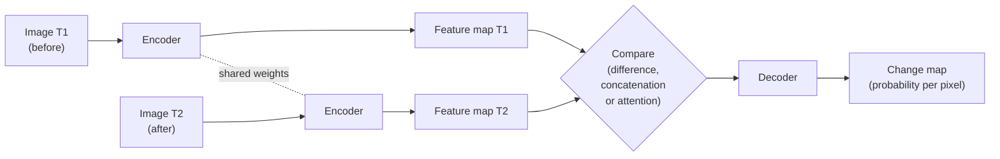

---
site:
  outline_maxdepth: 2
---

# Deep learning approaches

<!-- markdownlint-disable MD033-->
<div class="page-subtitle">
Deep learning architectures for comparing image pairs, such as Siamese networks
</div>
<!-- markdownlint-enable MD033 -->

---

The previous page's methods compared pixels one at a time, with no sense of the surrounding scene. This page explains, at a decision-oriented level, how deep learning models overcome that limitation, which data they are trained on, and how their results are evaluated. The next page then runs one such model, {term}`ChangeStar`, on real imagery.

---

## 1. Motivation

`geoai`'s ChangeStar workflow, used on pages 5–7 of this lesson, is built on the architecture family introduced here, and on page 8 you train one of these architectures, {abbr}`FC-Siam-diff (Fully Convolutional Siamese network, difference variant)`, yourself. Understanding the general idea, comparing learned features rather than raw pixels, is what makes both models' behaviour and outputs understandable instead of an unexplained black box. Knowing the main training datasets and evaluation metrics helps you judge whether a published model fits your project, and whether its reported accuracy means anything for your data.

---

## 2. Core idea

The dominant architecture for deep-learning change detection is the **{term}`siamese network <Siamese Network>`**: two parallel {term}`encoder <Encoder-Decoder Architecture>` branches with identical, shared weights process the two input images separately, extracting feature representations that capture spatial context, not just individual pixel values. A comparison module then identifies differences between the two feature maps at corresponding locations, and a decoder turns them into a full-resolution change map.



Because both branches share weights, they produce features in the same representation space, which is what makes a direct comparison between them meaningful in the first place.

---

## 3. How the comparison works

### A. Why spatial context helps

A pixel-wise method (previous page) cannot tell a genuinely changed rooftop from an isolated noisy pixel; both look the same to it, which is why its change masks look speckled. A siamese network's encoder branches extract features that incorporate surrounding context, edges, textures and shapes nearby. This helps the model learn to distinguish a real, spatially coherent change from scattered radiometric noise, and from changes that do not matter for the task, such as a moved car or a different shadow.

### B. Weight sharing

Both encoder branches in a siamese network have identical parameters. This is a deliberate design choice: it guarantees that a feature vector at a given position in the pre-change image lives in the same representation space as the feature vector at the same position in the post-change image. The comparison is then meaningful, rather than comparing two unrelated feature spaces. In practice, the "two" encoders are one network applied twice.

### C. How the two dates are combined

The main design decision is *where* the two dates meet and *how* they are compared:

| Strategy | How it works | Example models | In this lesson |
| --- | --- | --- | --- |
| **{term}`Early fusion <Early Fusion>`** | Stack both images into one input (for example 2 × 3 = 6 channels) and feed them through a single segmentation network | {abbr}`FC-EF (Fully Convolutional Early Fusion)` | – |
| **Siamese, difference** | Encode each date separately with shared weights, then subtract the feature maps | FC-Siam-diff | Trained on page 8 |
| **Siamese, concatenation** | Encode each date separately, then stack the feature maps and let later layers learn the comparison | FC-Siam-conc | – |
| **Attention / transformer** | Compare the two dates with attention, which can relate distant parts of the image and both time steps | STANet, {abbr}`BIT (Bitemporal Image Transformer)`, ChangeFormer | – |
| **Multi-task (semantic + change)** | Predict a land-cover or building map for each date *and* a change map, with a shared encoder | ChangeStar | Pages 5–7 |

Early fusion is the simplest, but the network must learn from scratch which channels belong to which date. Siamese designs build the "compare like with like" idea into the architecture. Attention-based models such as BIT ({term}`transformer <Transformer>`-based) can model long-range relationships, for example that a whole street of houses appeared, at the cost of more parameters. Multi-task models such as ChangeStar produce a categorical answer almost for free: if they know there was no building at T1 and a building at T2, they can report "new building", not just "changed". You do not need to memorise these architectures; the pattern to recognise is that the comparison step itself, not just the feature extraction, is a design choice.

```{tip}
When reading about a new change detection architecture, ask two questions: how does it extract features from each image (usually a shared-weight encoder), and how and where does it compare them (early fusion, subtraction, concatenation or attention)? Most architectures in this space are variations on those two choices.
```

### D. What the models learn from

Supervised change detection models learn from **labeled image pairs**: two co-registered images plus a {term}`ground truth <Ground Truth>` mask showing where change happened. Such labels are expensive, because an analyst must compare both dates for every object. A few public benchmark datasets therefore appear again and again in the literature:

| Dataset | Imagery | Labels | Notes |
| --- | --- | --- | --- |
| {abbr}`OSCD (Onera Satellite Change Detection)` | {term}`Sentinel-2`, 10–60 m, 13 bands | Binary urban change | 24 city pairs from around the world; used on page 8 |
| LEVIR-CD | Google Earth, 0.5 m | Binary building change | 637 pairs of 1024 × 1024 pixels, cities in Texas, 2002–2018 |
| {abbr}`WHU (Wuhan University)` Building {abbr}`CD (Change Detection)` | Aerial, very high resolution | Binary building change | Christchurch, New Zealand, before and after rebuilding following the 2011 earthquake |
| SECOND | Aerial, very high resolution | Land-cover class at both dates in changed areas | A benchmark for *semantic* (categorical) change detection |
| xBD (xView2) | Satellite, very high resolution | Building damage levels after disasters | Pre- and post-event pairs; one ChangeStar variant is fine-tuned on it |

Most benchmarks show **building or urban change** in a limited set of regions. A model trained on them has learned what building change looks like in that imagery, which is not the same as vegetation loss, flooding, or building change in a very different landscape. {term}`Changen2`, the pretraining behind ChangeStar, tackles the label shortage differently: it *generates* synthetic image pairs with perfect change labels, so a model can be pretrained on millions of examples before it sees any real labeled pair.

### E. Evaluating a change map

Evaluating a change map against reference labels works like evaluating a {term}`binary segmentation <Binary Segmentation>` in L07, with one twist: in almost every scene, **most pixels are unchanged**. This {term}`class imbalance <Class Imbalance>` makes {term}`accuracy <Accuracy>` misleading. Every predicted pixel falls into one cell of a {term}`confusion matrix <Confusion Matrix>`:

| | Reference: changed | Reference: unchanged |
| --- | --- | --- |
| **Predicted: changed** | {term}`True positive <True Positive>` (TP) | {term}`False positive <False Positive>` (FP), a false alarm |
| **Predicted: unchanged** | {term}`False negative <False Negative>` (FN), a missed change | {term}`True negative <True Negative>` (TN) |

From these counts, the metrics for the *change* class are:

- **{term}`Precision <Precision>`** = TP / (TP + FP): of everything flagged as change, how much was really change?
- **{term}`Recall <Recall>`** = TP / (TP + FN): of all real change, how much was found?
- **{term}`F1-score <F1-score>`** = 2 · Precision · Recall / (Precision + Recall): one number balancing both.
- **{term}`IoU <Intersection over Union>`** = TP / (TP + FP + FN): the overlap between predicted and reference change.

A worked example shows why these matter. Take a scene of 1,000,000 pixels in which 50,000 (5%) really changed:

| Model | TP | FP | FN | Accuracy | Precision | Recall | F1 | IoU |
| --- | --- | --- | --- | --- | --- | --- | --- | --- |
| A: predicts "no change" everywhere | 0 | 0 | 50,000 | **95%** | – | 0.00 | 0.00 | 0.00 |
| B: a real detector | 40,000 | 20,000 | 10,000 | 97% | 0.67 | 0.80 | 0.73 | 0.57 |

Model A is useless but scores 95% accuracy; only F1 and IoU reveal that it found nothing. Accuracy barely separates a useless model from a useful one, which is why change detection papers, and page 8 of this lesson, report F1 and IoU of the change class instead.

---

## 4. Common pitfalls

- **Assuming deep learning always outperforms traditional methods.** It generally handles spatial context and complex patterns better, but it needs representative training data (or, as the next page shows, effective pretraining). The unsupervised methods from the previous page remain useful when labeled data is unavailable.
- **Treating architecture choice as more important than data.** A siamese network trained on unrepresentative data will not automatically outperform a well-tuned traditional baseline on your imagery.
- **Trusting benchmark scores for your own data.** A model that scores well on LEVIR-CD has learned building change in Texan suburbs from Google Earth imagery; check how similar your imagery and change type are.
- **Reporting accuracy for a change map.** With most pixels unchanged, accuracy is almost always high; report precision, recall, F1 and IoU of the change class.
- **Forgetting that {term}`co-registration <Co-registration>` and comparability still matter.** A deep learning model tolerates more noise than pixel-wise differencing, but it does not remove the need for the checks from two pages ago.

---

## 5. Mini task

A classmate says: "Deep learning change detection works by training on pairs of images and just learning to predict the difference image, so it is basically the same idea as {term}`image differencing <Image Differencing>`." Identify what this description misses. Then answer: a colleague reports 96% accuracy for their change map of a scene in which 4% of the area changed. What would you ask them?

:::{dropdown} Sample solution
:class: note

The description misses that a siamese network compares learned *feature representations*, which incorporate spatial context (nearby edges, shapes, texture patterns), not raw pixel values. Image differencing cannot distinguish an isolated noisy pixel from a genuine, spatially coherent change, because it treats every pixel independently. A siamese network's shared-weight encoders capture that context before any comparison happens, and the network learns which differences matter for the task (a new building) and which do not (a moved car, a shadow). That is the source of its advantage, not "learning to predict a difference" in the pixel-arithmetic sense.

For the accuracy claim: with 4% changed area, a map that predicts "no change" everywhere already reaches 96% accuracy. You would ask for precision, recall, F1 or IoU of the change class, and how the reference data were collected.
:::

---

## 6. Key takeaways

- Siamese networks process two images through weight-sharing encoder branches, then compare the resulting feature representations, not raw pixels.
- Weight sharing ensures both branches produce features in the same representation space, making direct comparison meaningful.
- Architectures differ mainly in where and how the two dates are combined: early fusion, feature difference, concatenation, attention, or multi-task models that also segment each date.
- Supervised models learn from labeled image pairs; public benchmarks focus on building and urban change, which limits what pretrained models know.
- Because most pixels are unchanged, evaluate change maps with precision, recall, F1 and IoU of the change class, not accuracy.

### Further reading

- {term}`TorchGeo`, ["Change Detection"](https://docs.torchgeo.org/en/stable/tutorials/change_detection.html) tutorial — a different library's perspective on the same siamese-network family; [page 8](08_training-a-change-detector.ipynb) of this lesson builds on it.
- Daudt, Le Saux and Boulch (2018), ["Fully Convolutional Siamese Networks for Change Detection"](https://arxiv.org/abs/1810.08462) — the paper introducing FC-EF, FC-Siam-conc and FC-Siam-diff.
- Chen, Qi and Shi (2021), ["Remote Sensing Image Change Detection with Transformers"](https://arxiv.org/abs/2103.00208) — the BIT model, a transformer-based comparison module.
- Chen and Shi (2020), ["A Spatial-Temporal Attention-Based Method and a New Dataset for Remote Sensing Image Change Detection"](https://www.mdpi.com/2072-4292/12/10/1662) — STANet and the LEVIR-CD dataset.
- [Awesome Remote Sensing Change Detection](https://github.com/wenhwu/awesome-remote-sensing-change-detection) — a curated list of change detection papers, datasets and architectures.
- Esri, ["Multi-Class Change Detection Using Segmentation Deep Learning Models"](https://developers.arcgis.com/python/latest/samples/multi-class-change-detection-using-segmentation-deep-learning-models/) — a worked example of categorical (multi-class) change detection on a different platform.
