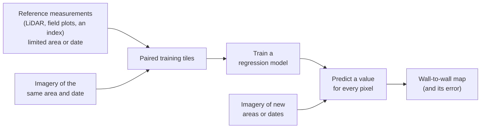

---
site:
  outline_maxdepth: 2
---

# When regression fits

<!-- markdownlint-disable MD033-->
<div class="page-subtitle">
Recognising when you need a continuous value per pixel, not a class
</div>
<!-- markdownlint-enable MD033 -->

---

The landing page introduced regression as predicting "how much" rather than "which class." This page surveys where that fits in practice, where the reference data comes from, and when classification, segmentation, or no model at all is the better choice.

---

## 1. Motivation

A continuous target forced into categorical bins loses information you cannot recover later. Deciding early whether your project's target is genuinely continuous, and whether you can obtain reference data to train on, shapes everything from data preparation through evaluation in the rest of this lesson.

---

## 2. Core idea

{term}`Pixel-level regression <Pixel-Level Regression>` fits when your target varies continuously across a landscape and the value itself, not just a category it falls into, is what your project needs. It always needs **reference data**: measurements of the target, available for a limited area or time, that are paired with imagery available everywhere. The model learns the relationship in the area where both exist and then extends it to the area where only imagery exists.



---

## 3. Points to consider

### A. Typical regression targets

| Target | Unit and range | Typical reference data | Typical imagery | In this lesson |
| --- | --- | --- | --- | --- |
| {term}`NDVI <Normalized Difference Vegetation Index>` and other indices | none, −1 to 1 | Computed from red and {term}`near-infrared <Near-Infrared>` bands | Multispectral, e.g. {term}`Sentinel-2` | Pages 4–7: the Beni river in Bolivia, 2018 and 2026 |
| {term}`Canopy height <Canopy Height>` | m, ≥ 0 | Airborne {term}`LiDAR`, stereo image matching | Aerial RGB, satellite | Page 8: two forest sites in Switzerland |
| Above-ground biomass | Mg/ha, ≥ 0 | Field plots, LiDAR, spaceborne LiDAR ({abbr}`GEDI (Global Ecosystem Dynamics Investigation, a lidar instrument on the International Space Station)`) | Multispectral, radar | |
| Soil moisture | m³/m³, 0 to about 0.6 | In-situ probes, coarse satellite products | Radar, thermal, multispectral | |
| Building height | m, ≥ 0 | LiDAR, stereo, cadastral 3D models | Aerial, very-high-resolution satellite | |
| Population density | people/km², ≥ 0 | Census counts per district | Built-up maps, night lights | |

Every row follows the same pattern: a direct but geographically limited measurement (LiDAR, field plots, census) is extended with imagery that covers the whole area. Two consequences follow. First, the quality of your map can never be better than the quality of your reference data. Second, the model only learns the relationship that holds where the reference data comes from; page 8 tests what happens when a canopy-height model is applied to a different forest.

### B. When another approach is better

If your target has a small number of meaningful, distinct categories, and the exact value within a category adds little, classification or segmentation (L05 and L07) are simpler and easier to interpret. Land cover is the typical example: "forest" versus "cropland" is often more useful to a downstream user than a continuous greenness value.

How much information does binning throw away? A quick measurement on the Beni NDVI map used later in this lesson: replacing every pixel with the mean of its class (three classes: below 0.2, 0.2 to 0.6, above 0.6) leaves a typical error of 0.11 NDVI, and up to 0.49 at the class edges. With five classes, the typical error is still 0.07. If differences of that size matter for your question, you need regression.

### C. When you need no model at all

Sometimes the target is a fixed formula of the input bands. NDVI is exactly ({term}`NIR <Near-Infrared>` − red) / (NIR + red), so with Sentinel-2 bands at hand you would simply compute it. Pages 4–7 still use NDVI as the target, deliberately: because the correct value is known exactly for every pixel and for both years, it is an ideal test case for learning the workflow, and for asking what the model needs. On page 5 you can remove the near-infrared band from the input; the model then has to *estimate* NDVI from colour and texture, a genuine regression problem. Page 8 then turns to a target that no formula can deliver: tree height from a single aerial photo.

```{admonition} A quick mental test
:class: tip
Ask: "If I had the exact continuous value at every pixel, would that be more useful to my project than a handful of categories?" If yes, ask two more questions: "Do I have reference measurements to train on?" and "Can I compute the value directly instead?" Regression is a strong candidate when the answers are yes, yes, and no.
```

---

## 4. Common pitfalls

- **Forcing a continuous target into artificial categories out of habit.** If your target is continuous and reference data supports regression, discretizing it early throws away information you may need later.
- **Assuming regression fits without confirming reference data exists.** Regression needs paired, continuous reference measurements; without them, there is nothing to train on and nothing to evaluate against.
- **Training a model for something you can compute.** If the target is a formula of your inputs (an index, a ratio), compute it; use a model only when information is missing.
- **Forgetting where the reference data comes from.** A model trained on LiDAR from lowland forests learns lowland forests; its errors grow where your study area differs.

---

## 5. Mini task

Your project estimates wildfire fuel load across a forested region. Would you frame this as classification, segmentation, or regression? What reference data would you need, and where might you realistically obtain it? What would limit the quality of your map?

:::{dropdown} Sample solution
:class: note

Fuel load is a continuous physical quantity (mass per unit area), so regression is the natural framing, provided reference measurements are available. Realistic sources are field plot measurements from forestry agencies or fire services, LiDAR-derived biomass estimates, or existing fuel models. Optical or radar imagery would be paired with these values to train the model, the same pattern as for canopy height and biomass.

The quality is limited by the reference data in two ways: its own measurement error (field plots are small and few, LiDAR-based fuel estimates are themselves models), and its coverage. If the plots come only from accessible, low-elevation stands, the model will be least reliable in exactly the remote, steep terrain where fire risk may be highest.
:::

---

## 6. Key takeaways

- Regression fits continuous targets, where the value matters more than a category, and requires paired reference measurements to train on.
- NDVI, canopy height, biomass, soil moisture, building height and population density are common geospatial regression targets.
- Regression extends geographically limited reference data (LiDAR, field plots, census) to wall-to-wall coverage using imagery; the map inherits the quality and coverage limits of that reference data.
- Classification or segmentation remain the better choice when a few meaningful categories answer the question; if the target is a formula of the bands, compute it instead.

### Further reading

- Lang, Jetz, Schindler and Wegner (2023), ["A high-resolution canopy height model of the Earth"](https://doi.org/10.1038/s41559-023-02206-6), *Nature Ecology & Evolution* 7, 1778–1789 — a global canopy height map from Sentinel-2, trained on spaceborne LiDAR.
- Tolan et al. (2024), ["Very high resolution canopy height maps from RGB imagery using self-supervised vision transformer and convolutional decoder trained on aerial lidar"](https://doi.org/10.1016/j.rse.2023.113888), *Remote Sensing of Environment* 300, 113888 — the same task as page 8 of this lesson, at global scale.
- [Canopy Height Estimation with GeoAI and Pretrained Models](https://youtu.be/vsIRTM98qaU) — a video walkthrough of a canopy-height regression workflow with `geoai`.
