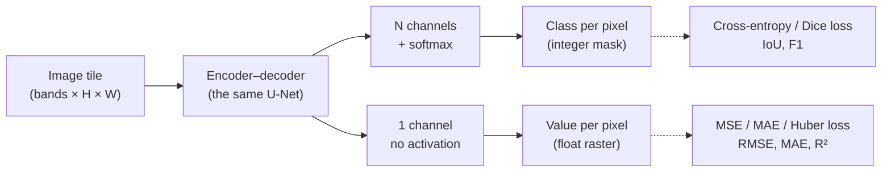

---
site:
  outline_maxdepth: 2
---

# Classific. vs. regression

<!-- markdownlint-disable MD033-->
<div class="page-subtitle">
Telling apart discrete-class problems from continuous-value problems
</div>
<!-- markdownlint-enable MD033 -->

---

You now know where regression applies. This page makes the conceptual shift explicit: what actually changes, mechanically, when a task moves from categorical to continuous prediction, before the next page covers architecture and loss function choices in more depth.

---

## 1. Motivation

`geoai`'s regression functions look deceptively similar to the segmentation functions from L07: the same kind of call, the same kind of paired image and label tiles. The differences are precise and consistent, and knowing exactly what they are will keep you from applying a segmentation habit (like checking IoU) where it no longer makes sense.

---

## 2. Core idea

{term}`Classification` (whether scene-level or pixel-level) selects among a fixed, predefined set of discrete labels. {term}`Regression` predicts a continuous numeric value with no fixed set of possible answers. The network in between can be exactly the same; the distinction only changes the two ends of the pipeline: what the last layer outputs and what the labels look like, and with them the loss and the evaluation.



---

## 3. What changes

| | Segmentation (L07) | Pixel regression (this lesson) |
| --- | --- | --- |
| Output layer | N channels, one score per class | 1 channel |
| Activation | Softmax (or sigmoid for one class) | None; the value can be any number |
| Label raster | Integer class index, `uint8` | Measured value, `float32` |
| Loss | Cross-entropy, {term}`Dice <Dice Loss>` | {term}`MSE <Mean Squared Error>`, {term}`MAE <Mean Absolute Error>`, {term}`Huber <Huber Loss>` |
| Evaluation | {term}`IoU <Intersection over Union>`, F1, accuracy | {term}`RMSE <Root Mean Squared Error>`, MAE, {term}`R² <R-squared>`, bias |
| A "nearly right" prediction | Still wrong if the class is wrong | Gets a small error, and a small penalty |
| Example | Water or not water | NDVI 0.72, tree height 23.4 m |

### A. Output layer

A classification model outputs N channels, one score per class, followed by a softmax activation that turns those scores into probabilities summing to one. A regression model outputs a single channel with no activation: the number that comes out *is* the prediction. `geoai` builds its regression models this way. If a target cannot be negative (height, biomass), the usual approach in `geoai` is to clip predictions to the valid range afterwards, which page 6 covers.

### B. Loss function

Classification typically uses cross-entropy loss, which penalizes assigning low probability to the correct class. Regression uses a {term}`loss function <Loss Function>` built around the *size* of the numeric error. A small example shows the difference. The true NDVI of a pixel is 0.70:

| Prediction | Error | Squared error (MSE) | Absolute error (MAE) | As a class ("dense vegetation" above 0.6) |
| --- | --- | --- | --- | --- |
| 0.68 | −0.02 | 0.0004 | 0.02 | correct |
| 0.55 | −0.15 | 0.0225 | 0.15 | wrong |
| 0.20 | −0.50 | 0.2500 | 0.50 | wrong |

In classification, 0.55 and 0.20 are equally wrong. In regression, closer predictions are always better, and the loss tells the model how much better. Squaring makes the large error count 625 times more than the small one, the main property that distinguishes MSE from MAE (next page).

### C. Evaluation metrics

Classification evaluation (accuracy, IoU, F1) asks "how often was the prediction the correct category?" Regression evaluation asks "how close, numerically, were the predictions to the actual values, and are they systematically too high or too low?" This calls for a different metric family (RMSE, MAE, R², bias), covered fully on page 7.

### D. Label format and data type

A segmentation label is an integer {term}`mask <Mask>`: each pixel stores a class index, so `uint8` is enough. A regression label is a floating-point raster: each pixel stores a measured value, so `float32` is the standard. Storing a continuous target as an integer type silently destroys precision: NDVI values of 0.72 and 0.31 would both become 0. When you prepare your own targets, check `src.dtypes` after loading and after saving.

The input side changes too, in a less obvious way: the input bands must be scaled consistently between training and prediction, because the model learns a relationship between input *values* and output *values*. Page 4 shows how `geoai` scales inputs, and page 8 what goes wrong with 8-bit aerial images if you do not check.

```{admonition} One mental model for all changes
:class: note
Every change on this page follows from the same root distinction: classification chooses among options, regression estimates a number. Once that is clear, the output layer, loss function, evaluation metrics and label format are just the consequences of that single shift, not separate things to memorize.
```

---

## 4. Common pitfalls

- **Storing a continuous target as an integer array.** This silently destroys the fractional precision regression depends on; always confirm your target raster's dtype is a floating-point type.
- **Applying classification evaluation habits to a regression result.** "Accuracy" or IoU make no sense for a continuous output; RMSE, MAE, R² and bias answer the actual question.
- **Assuming the architecture itself needs to change substantially.** As the next page shows, the encoder-decoder backbone barely changes; the differences concentrate in the output layer, loss and evaluation.
- **Binning the prediction to make it "look like" a classification.** If a project partner needs classes, derive them from the continuous map at the end, and keep the continuous map.

---

## 5. Mini task

A colleague trained what they believe is a regression model to predict building height, but all outputs come out as whole numbers (3, 7, 12, never 7.4 or 12.1). Using the ideas from this page, suggest the most likely cause. Then: their RMSE is 2.1 m. Can you compare this with the IoU of 0.78 from their earlier building segmentation?

:::{dropdown} Sample solution
:class: note

The most likely cause is that the target raster (or the output array) was stored or cast as an integer type at some point in the pipeline, rounding away the fractional precision a continuous height value should have. The fix is to keep the target as `float32` throughout data preparation, training and inference.

The two numbers cannot be compared. IoU measures how well predicted building *areas* overlap the reference areas (a share, without unit); RMSE measures how far predicted *heights* are from the reference heights, in metres. They answer different questions, and a model can be good at one and poor at the other.
:::

---

## 6. Key takeaways

- The same encoder-decoder network serves both tasks; only the output layer, the labels, the loss and the evaluation change.
- Regression uses a single output channel without activation, instead of N channels with softmax.
- Regression losses and metrics measure the size of numeric errors, so a nearly right prediction is rewarded, unlike in classification.
- Regression labels must be floating-point rasters, and input scaling must be identical between training and prediction.

### Further reading

- Goodfellow, Bengio and Courville (2016), [*Deep Learning*, chapter 6.2.2 "Output Units"](https://www.deeplearningbook.org/contents/mlp.html) — why linear output units go with squared-error losses and softmax units with cross-entropy.
